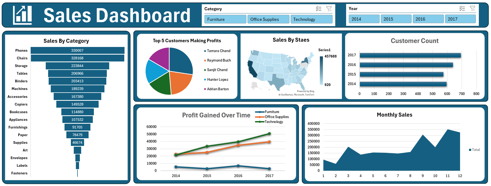

# 📗 Excel Projects

## Superstore Sales Dashboard

An interactive Excel dashboard built on the Sample Superstore dataset (2014-2017).

### 📌 Key Highlights
- Cleaned and analyzed the Superstore data using Excel
- Built Pivot Tables for Sales by Category, Monthly Sales and Customer Count
- Identified Top 5 profitable customers
- Interactive dashboard with Category and Year slicers

### 📂 Files
- [Raw Data (CSV)](Superstore-Raw-Data.csv)
- [Dashboard File (Excel)](Superstore_Project.xlsx)
- [Dashboard Screenshot](Superstore_Dashboard.png)

### 🛠️ Tools Used
Excel, Pivot Tables, Slicers, Data Cleaning
